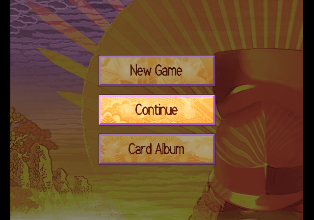
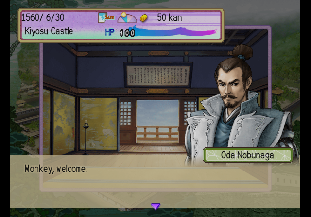
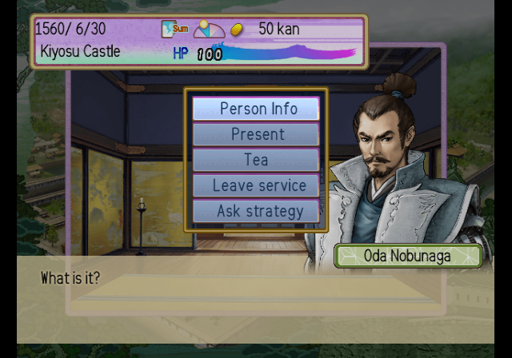
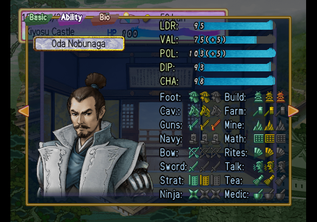
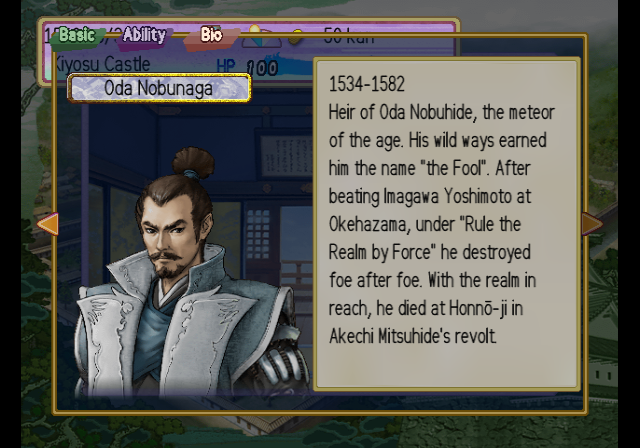
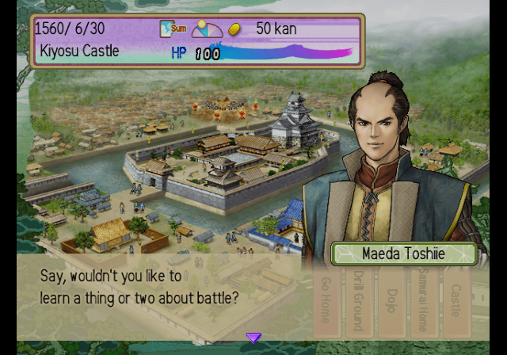

# Taiko Risshiden IV — English Translation

A fan translation of **Taiko Risshiden IV** (太閤立志伝IV, Koei, 2001) for the
PlayStation 2 into English. Taiko Risshiden is Koei's Sengoku-era life simulation:
you live the life of a samurai officer, starting as Kinoshita Tōkichirō (the later
Toyotomi Hideyoshi) or another officer of the age, and rise in the world.
The game was only released in Japan.

> **This is a full machine translation.** All of the game's text was translated from
> Japanese by an AI model, not by a human translator, and it has not been
> proofread by a fluent Japanese speaker. Expect occasional mistranslations, awkward
> phrasing and inconsistent terms. Corrections are welcome.

> **This is a beta.** All of the game's text is in English, but only the first hours
> of one career have been played. Most story event scenes, real battles and the later
> game have not been seen in play. Expect text that overflows its box, odd line
> breaks or untested scenes.

This repository contains the English text and the tools that build the patch.
It does **not** contain the game, any of its data, or the Japanese script — you need
your own copy of the game.

## Screenshots

| | | |
|:-:|:-:|:-:|
|  |  |  |
| Title menu | Dialogue | Castle menu |
|  |  |  |
| Abilities | Officer biography | Event scene |

## What's translated

- All of the game's message text: town and job dialogue, commands, missions, councils,
  duels, battles, mini-games, help pages and guides, item and card descriptions, and
  all officer biographies
- Menus, labels and system messages, including memory card messages
- All story event scenes: the opening, tutorials, career and historical events
  (about 27,500 lines of dialogue, narration and choices)
- 735 officer and character names, romanised with macrons (Tōkichirō, Ōtomo Sōrin),
  plus castles, towns, provinces, items, court titles, ranks and cards
- Scenario titles and introductions
- Graphics: title menu, buttons, tabs, town facility plates, card names, battle and
  mini-game labels, redrawn at build time with an original English font
- A proportional English font with word wrap
- English name entry for new officers: a letter grid (A–Z, a–z, digits), up to 15 + 13
  letters ([screenshot](docs/screenshots/07_name_entry.png))

Long names and labels are shortened where the game's boxes are too small.

## Applying the patch (players)

1. Download the release zip (`Taiko_Risshiden_IV_English_v<version>.zip`) from the
   Releases page. It contains the patch, `taiko_risshiden_4_en_v<version>.xdelta`.
2. Check your unmodified disc image. The game is a PlayStation 2 **CD**, serial
   `SLPM-62105`; the patch is for a raw image (`.bin` with a `.cue`, 2352-byte sectors):

   | | |
   |---|---|
   | Size  | 455,224,896 bytes |
   | CRC32 | `40C1BE2B` |
   | MD5   | `56a6636542bf2ad9e256cf0a1f83f876` |
   | SHA-1 | `c932ea1de4247240a2868064f9deb21bc53cba30` |

   If your image does not match, it has been modified or is a different dump (for
   example an `.iso` with 2048-byte sectors), and the patch will not apply.

3. Apply it to the `.bin` with an xdelta tool, e.g.
   [Delta Patcher](https://github.com/marco-calautti/DeltaPatcher) or the command line:

   ```
   xdelta3 -d -s taiko_risshiden_4.bin taiko_risshiden_4_en_v<version>.xdelta taiko_risshiden_4_en_v<version>.bin
   ```

4. The `.cue` of your dump still works: copy it next to the patched `.bin` and change
   the file name on its `FILE` line. Recent PCSX2 versions do not open `.cue` files;
   load the `.bin` directly.

The patched image has the same serial, so it uses the same memory card saves as the
Japanese game. Officer names are stored in the save: a save made with the Japanese
game keeps its Japanese names, so start a new game.

## Building from source

Requirements: Python 3.10+, `xdelta3` (for the patch file).

```
python -m venv .venv
.venv/bin/pip install -r requirements.txt
cp /path/to/your/disc.bin taiko_risshiden_4.bin   # must match the checksums above
.venv/bin/python tools/setup.py                   # extracts script/ from your disc, applies tl/
.venv/bin/python tools/build.py                   # writes build/taiko_risshiden_4_en.bin + .cue + .xdelta
```

`tools/setup.py` checks the disc's SHA-1 and generates `script/` and `extract/`: the
Japanese text and the two game files from your disc, paired with the English from
`tl/`. `script/`, `extract/` and `build/` are never committed. Re-run `setup.py` after
editing a `tl/msgNN.txt` file.
The build is reproducible: the same disc and sources give a byte-identical patch.

To make a release package, run `.venv/bin/python tools/package.py <version>` after building:
it writes `release/<name>_v<version>.zip` with the versioned xdelta patch and a plain-text
README.txt. The disc image itself is never packaged.

## Repository layout

| Path | Contents |
|---|---|
| `tl/msgNN.txt` | English for each block of the message file, by entry number (`@N`) |
| `tl/elfstr.txt` | English for strings in the game program, by address |
| `tl/tables/` | English for the program's name tables (castles, items, offices, cards, ...) |
| `tl/names_persons.json` | English officer and character names |
| `tl/ev/NN.txt`, `tl/ev/names.txt` | English for the event scripts, by file, script and string number; event-only names |
| `tl/scenarios.txt`, `tl/gfx.txt` | Scenario titles and introductions; text drawn into graphics |
| `tools/setup.py`, `tools/build.py` | Create `script/`; build the patched disc and the patch |
| `tools/tl.py`, `elftl.py`, `evtl.py` | Validate and apply translations (`show`, `apply`, `stats`) |
| `tools/cdimage.py`, `datafile.py`, `msgfile.py`, `msgscript.py`, `evscript.py`, `text.py` | Raw CD image (sector encoder), archive, message and event-script formats |
| `tools/vwf.py`, `latinfont.py`, `meswin.py`, `msgbuf.py`, `scriptbuf.py`, `statusbar.py` | Proportional font, word wrap, message window and buffer patches |
| `tools/names.py`, `scenhdr.py`, `elfstr.py`, `elftables.py`, `elfseg.py`, `skillnames.py`, `nameentry.py` | Names, scenario headers, program text, the English data segment and name entry |
| `tools/sentcase.py`, `printfnum.py` | Sentence capitals and plurals at run time; English numbers and money |
| `tools/ftx.py`, `gfx.py` | Texture format and redrawn graphics |
| `tools/package.py` | Makes the release zip (patch + README.txt with checksums) |
| `tools/dev/`, `tools/emu/` | Development helpers (disassembly, PCSX2 automation) |

## Known issues

- **Most of the game is not play-tested.** Checked in play: the opening, castle town
  and its shops, the first councils and missions, duels, a mock battle, several
  mini-games, the lists and help pages. Reports with a screenshot are welcome.
- Long names are squeezed in narrow list columns and on small plates; they stay readable.
- A few labels are abbreviated to fit ("Cav.", "S. General"), and court titles use a
  short form ("Owari-kami").
- Some graphics are left in Japanese: the title logo, room signboards and a few
  decorative inscriptions.
- A sentence that starts after a quotation is sometimes capitalised wrongly.
- Creating a new officer is only lightly tested. Its name entry has no space, apostrophe
  or macron keys, and the reading fields are gone (readings are not shown in English).
- Saves made before patching keep their Japanese officer names.

Tested in PCSX2 only. Bug reports with a screenshot and where it happened are welcome.

## Credits

- Translation and hacking: [damon-daemon](https://github.com/damon-daemon)
- Taiko Risshiden IV © Koei Tecmo. This is an unofficial fan project, not affiliated
  with or endorsed by Koei Tecmo. Please support the official releases.

## License

The tools, fonts, documentation and English translation text in this repository
are released under the [MIT License](LICENSE). This covers only original work in
this repository: the game itself and all of its content (code, Japanese text,
graphics, audio) are copyright Koei Tecmo and are not included or licensed here.
